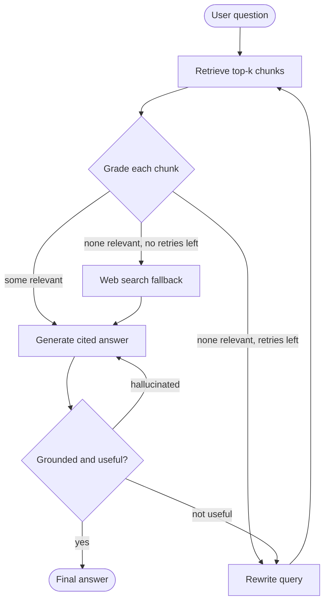

# 🔁 Self-Correcting RAG

A Retrieval-Augmented Generation (RAG) app that **grades its own retrieval and checks its own answers for hallucinations**. Instead of the usual one-pass *Retrieve → Generate* pipeline, it runs as a closed-loop state machine that can rewrite queries, fall back to web search, and regenerate answers.

Built with LangGraph, ChromaDB, Groq and Streamlit.

## ✨ Features

- **Semantic search** over your own PDFs using local embeddings and ChromaDB
- **Retrieval grading:** an LLM judge discards irrelevant chunks before generation
- **Query rewriting:** vague questions are reformulated and retried automatically
- **Web fallback:** Tavily search is used only when your documents don't contain the answer
- **Hallucination check:** the answer is verified as *grounded* in the sources and *useful*; if not, it is regenerated or re-searched
- **Cited answers:** inline `[source: file, p.N]` references plus an expandable sources panel
- **Live Streamlit UI:** streaming answers, a step-by-step log with timings, chat history, and sidebar controls
- **Loop safety:** a configurable retry limit prevents infinite loops

## 🧠 How it works



| Step | What happens |
|---|---|
| **Retrieve** | The question is embedded and the closest chunks are fetched from ChromaDB |
| **Grade** (Gate 1) | A fast LLM judges every chunk in parallel and keeps only the relevant ones |
| **Rewrite** | An LLM turns the question into a sharper search query and retries |
| **Web fallback** | If the documents fail after the retry limit, Tavily provides external context (once) |
| **Generate** | A larger LLM answers using only the verified context, with citations |
| **Check** (Gate 2) | A judge LLM verifies the answer is grounded in the sources and answers the question |

> This system is **not trained or fine-tuned**. It uses pretrained models, and your documents are *indexed*, not learned.

## 🛠️ Tech stack

| Layer | Tool |
|---|---|
| Orchestration | LangGraph |
| PDF parsing and chunking | PyMuPDF, `RecursiveCharacterTextSplitter` |
| Embeddings (local) | `BAAI/bge-small-en-v1.5` |
| Vector database | ChromaDB |
| LLMs (Groq) | `openai/gpt-oss-20b` (grading, rewriting) · `openai/gpt-oss-120b` (answers, verification) |
| Optional LLM | Gemini 2.5 Flash |
| Web search | Tavily |
| Structured output | Pydantic + JSON parsing |
| UI | Streamlit |

## 📁 Project structure

```
self-correcting-rag/
├── app.py                 # Streamlit UI (entry point)
├── requirements.txt
├── .env.example           # template for API keys
├── .streamlit/config.toml # theme and performance settings
├── data/                  # put your PDFs here
├── vector_db/             # auto-generated ChromaDB index (git-ignored)
└── src/
    ├── config.py          # models, chunk size, retry limits, key loading
    ├── ingestion.py       # PDF → chunks → embeddings → vector DB
    ├── state.py           # LangGraph state + Pydantic schemas
    ├── nodes.py           # retrieve, grade, rewrite, web search, generate, check
    └── graph.py           # wires the nodes into the workflow
```

## 🚀 Setup

**1. Clone and create a virtual environment**
```bash
git clone https://github.com/YOUR-NAME/self-correcting-rag.git
cd self-correcting-rag
python -m venv venv
```
Activate it: `venv\Scripts\activate` (Windows) or `source venv/bin/activate` (Mac/Linux).

**2. Install dependencies**
```bash
pip install -r requirements.txt
```

**3. Add your API keys**

Copy `.env.example` to `.env` (`copy .env.example .env` on Windows, `cp` on Mac/Linux) and fill in:
```
GROQ_API_KEY=gsk_...
TAVILY_API_KEY=tvly-...
GEMINI_API_KEY=...        # optional
```
- Groq (required): https://console.groq.com/keys
- Tavily (web fallback): https://app.tavily.com
- Gemini (optional): https://aistudio.google.com/apikey

**4. Add documents and build the index**

Put text-based PDFs in `data/`, then run:
```bash
python -m src.ingestion
```
Re-run this whenever your PDFs change (or use the **Index documents** button in the app).

**5. Run the app**
```bash
streamlit run app.py
```
Open http://localhost:8501.

## 💬 Usage

- Ask questions in the chat box. Open **How I answered** under a reply to see each step and its timing.
- Open **Sources** to see which file and page each answer came from.
- Sidebar controls:
  - **Verify answer:** toggle the hallucination check (off = faster)
  - **Max self-correction retries:** 0–3
  - **Add PDFs / Index documents / Clear chat**

Example log for a question the documents can't answer:
```
🔎 Retrieved 4 chunks
🧪 Kept 0/4 relevant chunks
✏️ Rewrote query → "..."
🔎 Retrieved 4 chunks
🧪 Kept 0/4 relevant chunks
🌐 Web fallback: 3 results
✍️ Generated answer (attempt 1)
🛡️ Verified → grounded ✅ · useful ✅
```

## ⚙️ Configuration

Edit `src/config.py`, or override models in `.env`:

| Setting | Default | Purpose |
|---|---|---|
| `CHUNK_SIZE` / `CHUNK_OVERLAP` | 1000 / 150 | Chunking (characters) |
| `TOP_K` | 4 | Chunks retrieved per search |
| `DEFAULT_MAX_RETRIES` | 1 | Self-correction loops |
| `GROQ_FAST_MODEL` | `openai/gpt-oss-20b` | Grader and rewriter |
| `GROQ_GENERATOR_MODEL` | `openai/gpt-oss-120b` | Answers and verification |
| `GENERATOR_PROVIDER` | `groq` | Set to `gemini` to use Gemini for answers |

## 🧪 Evaluating hallucinations

Good test questions:
1. **Answerable facts:** check the cited page against the PDF
2. **Near-miss questions:** related to the PDF but not answered in it (the system should say it doesn't know)
3. **False-premise questions:** asking about things the document never says
4. **Exact numbers and lists:** count steps and values against the source
5. **Off-topic questions:** should trigger the web fallback

## 🩹 Troubleshooting

| Problem | Fix |
|---|---|
| `model_not_found` | Groq changed its model list. Set `GROQ_FAST_MODEL` / `GROQ_GENERATOR_MODEL` in `.env` |
| 401 Invalid API Key | Create a new Groq key (`gsk_...`), update `.env`, restart Streamlit |
| `No PDFs found in data/` | Add a text-based PDF and re-run ingestion |
| Always falls back to web | Check the log for `Kept 0/4`; try a more specific question or raise `TOP_K` |
| Settings changes not applied | Stop Streamlit (`Ctrl+C`) and start it again |

## ⚠️ Limitations

- The groundedness check is itself an LLM, so it can miss subtle errors or reject good answers. "Grounded" means *supported by the sources*, not *true*.
- Broad questions such as "summarize this document" work poorly because only a few chunks are retrieved.
- Scanned (image-only) PDFs are not supported without OCR.
- Retrieved text is sent to hosted LLM APIs, so avoid confidential documents.

## 🔮 Future improvements

- Cross-encoder reranker (e.g. `bge-reranker-base`) for higher retrieval precision
- Hybrid search (BM25 + vectors)
- Evaluation script with a labelled question set
- OCR support for scanned PDFs

## 👤 Author

Built by **Sana Shaikh** as a GenAI mini project.
